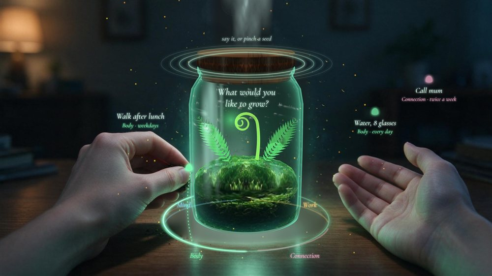
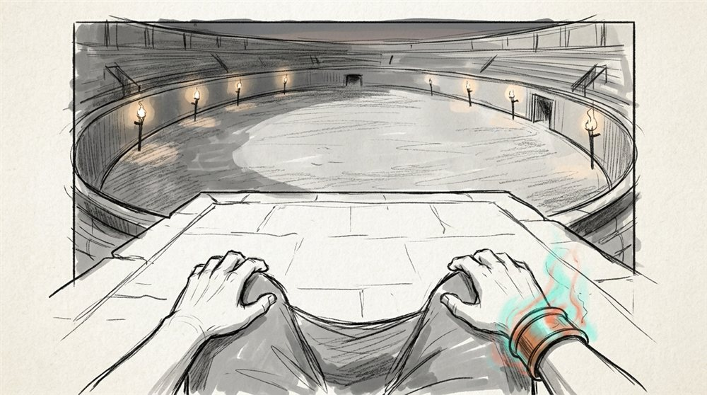

<picture>
  <source media="(prefers-color-scheme: light)" srcset="assets/header-light.svg?v=20261014" />
  
</picture>

  

I build local-first software: tools that run on your machine, keep your data there, and put AI agents to work on real projects. Most of it is TypeScript and Rust, with some C++ and C# when the target is a VR headset.

---

### 01 · Specification

- **Local-first by default.** State lives in SQLite on the user's machine. Nothing leaves unless they send it.
- **Agents do the work, people approve it.** Claude Code runs headless, behind gates a person controls.
- **Ship the whole thing.** Desktop app, backend, observability and the site that explains it.

<picture>
  <source media="(prefers-color-scheme: light)" srcset="assets/architecture-light.svg?v=20261014" />
  
</picture>

---

### 02 · Build Log

<picture>
  <source media="(prefers-color-scheme: light)" srcset="assets/stats-light.svg?v=20261014" />
  
</picture>

<picture>
  <source media="(prefers-color-scheme: light)" srcset="assets/pulse-light.svg?v=20261014" />
  
</picture>

<picture>
  <source media="(prefers-color-scheme: light)" srcset="assets/timeline-light.svg?v=20261014" />
  
</picture>

<!-- BUILDLOG:START -->
`2026-10-13` &nbsp;**[athena-portable](https://github.com/xkazm04/athena-portable)** &nbsp;PYTHON 
Athena: a personal AI agent that works inside your web apps and asks before it acts. NVIDIA Nemotron on Nebius Token Factory red-teams her gate.

`2026-10-13` &nbsp;**[pof](https://github.com/xkazm04/pof)** &nbsp;TYPESCRIPT 
AI-powered companion for building Unreal Engine 5 C++ games — checklists, feature tracking, and quality evaluation from prototype to polish.

`2026-10-13` &nbsp;**[ai-registry](https://github.com/xkazm04/ai-registry)** &nbsp;JAVASCRIPT 
Example AI development registry - skills, practices and org memory that ascent onboards, indexes and tracks.

`2026-10-13` &nbsp;**[bp](https://github.com/xkazm04/bp)** &nbsp;TYPESCRIPT 
bípípí

`2026-10-13` &nbsp;**[systedo-case](https://github.com/xkazm04/systedo-case)** &nbsp;TYPESCRIPT 
Adamant — AI ad intelligence on your machine: measure, triage and generate ad assets across Google Ads, Sklik, Meta and TikTok.

`2026-10-13` &nbsp;**[kp](https://github.com/xkazm04/kp)** &nbsp;TYPESCRIPT 
open-source hiring workspace

`2026-10-13` &nbsp;**[pumper](https://github.com/xkazm04/pumper)** &nbsp;RUST 
Local-first scraping service — one Rust binary, durable SQLite job queue, three pluggable scrape engines (HTTP, browser, Claude Code).

`2026-10-13` &nbsp;**[garden-vr](https://github.com/xkazm04/garden-vr)** &nbsp;C# 
Two calm, hands-first daily-ritual apps (Unity, Meta Quest) that grow a living garden from real habits. Meta VR Start Developer Competition 2026.
<!-- BUILDLOG:END -->

---

### 03 · Assemblies

<picture>
  <source media="(prefers-color-scheme: light)" srcset="assets/cards-light.svg?v=20261014" />
  
</picture>

<table>
<tr>
<td width="50%" valign="top">

**A · Agent platforms & dev tooling**

**[personas](https://github.com/xkazm04/personas)** &nbsp;TAURI 2 · REACT 19 · SQLITE 
Desktop app for building AI agents, wiring them to your tools, running them on triggers and orchestrating teams of them on real software projects.

**[vibeman](https://github.com/xkazm04/vibeman)** &nbsp;NEXT.JS 16 · CLAUDE CODE · OLLAMA 
Project control room that runs tasks through up to four concurrent Claude Code sessions or local models.

**[pof](https://github.com/xkazm04/pof)** &nbsp;NEXT.JS · UNREAL ENGINE 5 
Companion for UE5 C++ games: checklists, feature tracking, quality evaluation and an embedded Claude Code terminal with domain skill packs.

**[ascent](https://github.com/xkazm04/ascent)** &nbsp;TYPESCRIPT 
Scores how AI-native a team's engineering is, from 0 to 100 across nine weighted dimensions, with evidence and a path to the next level.

</td>
<td width="50%" valign="top">

**B · Rust infrastructure**

**[lighttrack](https://github.com/xkazm04/lighttrack)** &nbsp;RUST · SQLITE / POSTGRES / FIRESTORE 
Self-hosted LLM observability with LLM-as-judge scoring. One container, your own database.

**[pumper](https://github.com/xkazm04/pumper)** &nbsp;RUST · SQLITE 
Scraping service in one binary with a durable job queue and three engines that escalate from HTTP to browser to Claude Code.

**C · Hands-first VR** &nbsp;META VR START 2026

**[garden-vr](https://github.com/xkazm04/garden-vr)** &nbsp;UNITY · META QUEST 
Two calm daily-ritual apps that grow a living garden from real habits.

**[mage-arena](https://github.com/xkazm04/mage-arena)** &nbsp;UNREAL ENGINE 5 · META QUEST 
Seated spell duel played with your hands.

</td>
</tr>
<tr>
<td width="50%" valign="top">

**D · Media & data**

**[gravitone](https://github.com/xkazm04/gravitone)** &nbsp;PYTHON · ARM 
ElevenLabs-compatible TTS with voice cloning, CPU-only: 4.26× realtime on Graviton4 at about $0.0004 per audio-minute.

**[stat-reel](https://github.com/xkazm04/stat-reel)** &nbsp;TYPESCRIPT 
Turns licensed sports data into 1 to 3 minute data-visualisation videos.

**[systedo-case](https://github.com/xkazm04/systedo-case)** &nbsp;TYPESCRIPT 
Ad intelligence on your machine across Google Ads, Sklik, Meta and TikTok.

**[MiSu](https://www.youtube.com/watch?v=Kam3LOzbPoI)** &nbsp;Prompt engineering 
AI generated music album. I told it to make great music...and it does

</td>
<td width="50%" valign="top">

**E · Civic & experiments**

**[politicas](https://github.com/xkazm04/politicas)** &nbsp;TYPESCRIPT · CS / EN 
Public-accountability platform for Czech politics: MP scoring, voting records, money ties and budgets on one entity graph.

**[athena-portable](https://github.com/xkazm04/athena-portable)** &nbsp;PYTHON · HACKATHON 
Personal agent that works inside your web apps and asks before it acts.

**[paypal](https://github.com/xkazm04/paypal)** &nbsp;RUST · HACKATHON 
The Table: agent-to-agent haggling over PayPal.

</td>
</tr>
</table>

<picture>
  <source media="(prefers-color-scheme: light)" srcset="assets/vr-light.svg?v=20261014" />
  
</picture>

<picture>
  <source media="(prefers-color-scheme: light)" srcset="assets/civic-light.svg?v=20261014" />
  
</picture>

---

### 04 · Toolbox

<picture>
  <source media="(prefers-color-scheme: light)" srcset="assets/toolbox-light.svg?v=20261014" />
  
</picture>

---|---|
| **Languages** | TypeScript · Rust · Python · C++ · C# |
| **Apps** | React 19 · Next.js 16 · Tauri 2 · Tailwind v4 |
| **Data** | SQLite · PostgreSQL · Firestore |
| **AI** | Claude Code · MCP · LLM-as-judge · Ollama |
| **XR** | Unreal Engine 5 · Unity · Meta Quest |

---

kazii · The Builder · assets regenerated daily by GitHub Actions

