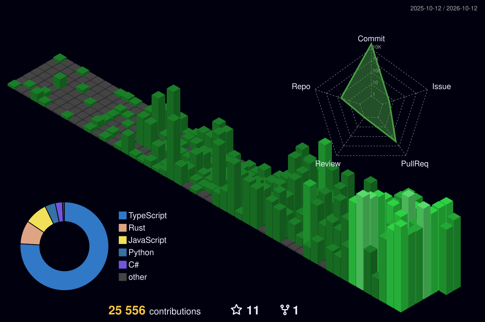

<div align="center">

<!-- HEADER -->


[](https://github.com/xkazm04)

<br/>

<a href="https://github.com/xkazm04?tab=followers">
  
</a>


<br/><br/>

<a href="https://www.linkedin.com/in/michalkazdan"></a>

</div>

<br/>

## About Me

```rust
pub struct Kazii {
    focus: [&'static str; 4],
    stack: Stack,
    principle: &'static str,
}

impl Default for Kazii {
    fn default() -> Self {
        Self {
            focus: [
                "Local-first desktop apps for building & orchestrating AI agents",
                "Developer tooling that drives Claude Code headless",
                "Self-hosted Rust infra: LLM observability, scraping, job queues",
                "Hands-first VR games for Meta Quest (Unity + Unreal 5)",
            ],
            stack: Stack {
                languages: &["TypeScript", "Rust", "Python", "C++", "C#"],
                frontend:  &["React 19", "Next.js 16", "Tailwind v4", "Tauri 2"],
                data:      &["SQLite", "PostgreSQL", "Firestore"],
                ai:        &["Claude Code", "MCP", "LLM-as-judge", "Ollama"],
            },
            principle: "your data stays on your machine unless you send it",
        }
    }
}
```

<!-- STATS:START -->
<div align="center">


</div>
<!-- STATS:END -->

---

<div align="center">

## Contribution Graph

<picture>
  <source media="(prefers-color-scheme: dark)" srcset="https://raw.githubusercontent.com/xkazm04/xkazm04/output/snake-dark.svg" />
  <source media="(prefers-color-scheme: light)" srcset="https://raw.githubusercontent.com/xkazm04/xkazm04/output/snake.svg" />
  
</picture>

</div>

---

## Featured Projects

### 🤖 AI Agents & Developer Tooling

| | Project | What it is |
|:--:|---------|------------|
| 🧑‍🤝‍🧑 | [**personas**](https://github.com/xkazm04/personas) | Local-first desktop app for building AI agents, wiring them to your tools, running them on triggers and orchestrating teams of them on real software projects. **Tauri 2 + React 19**, encrypted credentials, state in SQLite. |
| 🎛️ | [**vibeman**](https://github.com/xkazm04/vibeman) | Project control room that runs tasks through Claude Code CLI (up to 4 concurrent sessions) or local Ollama models. **Next.js 16 + SQLite** |
| 🎮 | [**pof**](https://github.com/xkazm04/pof) | AI companion for Unreal Engine 5 C++ games: checklists, feature tracking, quality evaluation, and an embedded Claude Code terminal with domain skill packs. |
| 📈 | [**ascent**](https://github.com/xkazm04/ascent) | Scores how AI-native a team's engineering is: 0–100 maturity across 9 weighted dimensions, with evidence and a prioritized path to the next level. |
| 🗂️ | [**ai-registry**](https://github.com/xkazm04/ai-registry) | Example AI development registry: skills, practices and org memory that ascent onboards, indexes and tracks. |

### 🦀 Rust Infrastructure

| | Project | What it is |
|:--:|---------|------------|
| 🔦 | [**lighttrack**](https://github.com/xkazm04/lighttrack) | Self-hosted LLM observability with LLM-as-judge scoring. One container, your choice of **SQLite, Postgres or Firestore**. |
| 🕷️ | [**pumper**](https://github.com/xkazm04/pumper) | Local-first scraping service: one Rust binary, durable SQLite job queue, three engines (HTTP → browser → Claude Code) with automatic escalation. |

### 🥽 Games & XR

| | Project | What it is |
|:--:|---------|------------|
| 🌱 | [**garden-vr**](https://github.com/xkazm04/garden-vr) | Two calm, hands-first daily-ritual apps for Meta Quest that grow a living garden from real habits. **Unity** · Meta VR Start Developer Competition 2026 |
| 🧙 | [**mage-arena**](https://github.com/xkazm04/mage-arena) | Seated, hands-first spell duel for Meta Quest. **Unreal Engine 5** · Meta VR Start Developer Competition 2026 |

### 🎬 Media, Data & Civic Tech

| | Project | What it is |
|:--:|---------|------------|
| 🔊 | [**gravitone**](https://github.com/xkazm04/gravitone) | ElevenLabs-compatible TTS with voice cloning, CPU-only on Arm: **4.26× realtime on Graviton4**, ~$0.0004 per audio-minute. Arm AI Optimization Challenge. |
| 📊 | [**stat-reel**](https://github.com/xkazm04/stat-reel) | Local-first studio that turns licensed sports data into 1–3 minute data-visualisation videos. |
| 📣 | [**systedo-case**](https://github.com/xkazm04/systedo-case) | Adamant: AI ad intelligence on your machine across Google Ads, Sklik, Meta and TikTok. |
| 🏛️ | [**politicas**](https://github.com/xkazm04/politicas) | Public-accountability platform for Czech politics: MP scoring, voting records, money ties and budgets on one entity graph. CS/EN. |
| 🏆 | [**goat**](https://github.com/xkazm04/goat) | Create and rank custom Top-N lists through a drag-and-drop match system. |

### ⚡ Hackathons

| | Project | What it is |
|:--:|---------|------------|
| 💸 | [**paypal**](https://github.com/xkazm04/paypal) | The Table: agent-to-agent haggling over PayPal. |
| 🛡️ | [**athena-portable**](https://github.com/xkazm04/athena-portable) | A personal AI agent that works inside your web apps and asks before it acts; NVIDIA Nemotron red-teams her approval gate. |

---

## Recently Shipped

<!-- RECENT:START -->
| Repo | Language | Pushed | About |
|------|:--------:|:------:|-------|
| [**bp**](https://github.com/xkazm04/bp) | TypeScript | 2026-10-12 | bípípí |
| [**ai-registry**](https://github.com/xkazm04/ai-registry) | JavaScript | 2026-10-12 | Example AI development registry - skills, practices and org memory that ascent onboards, indexes and tracks. |
| [**pumper**](https://github.com/xkazm04/pumper) | Rust | 2026-10-12 | Local-first scraping service — one Rust binary, durable SQLite job queue, three pluggable scrape engines (HTTP, browser, Claude Code). |
| [**ascent**](https://github.com/xkazm04/ascent) | TypeScript | 2026-10-12 | Scores how AI-native a team's engineering is — a 0-100 maturity score across 9 weighted dimensions, with evidence and a prioritized path to the next level. |
| [**gravitone-gcloud**](https://github.com/xkazm04/gravitone-gcloud) | TypeScript | 2026-10-12 | Content creation studio prototyped UI-first — Next.js 16, React 19, Tailwind v4. |
| [**garden-vr**](https://github.com/xkazm04/garden-vr) | C# | 2026-10-12 | Two calm, hands-first daily-ritual apps (Unity, Meta Quest) that grow a living garden from real habits. Meta VR Start Developer Competition 2026. |
| [**mage-arena**](https://github.com/xkazm04/mage-arena) | C++ | 2026-10-12 | Seated, hands-first spell duel for Meta Quest (Unreal Engine 5.8) - Meta VR Start Developer Competition 2026 |
| [**personas**](https://github.com/xkazm04/personas) | TypeScript | 2026-10-12 | Local-first desktop app for building AI agents, connecting them to your tools, running them on triggers, and orchestrating teams of them on real software projects. |

<sub>Auto-updated daily by GitHub Actions.</sub>
<!-- RECENT:END -->

---

## Tech Stack

<div align="center">

### Languages


### Apps & Frontend


### Data & Infra


### AI & XR


</div>

---

## GitHub Stats

<div align="center">


</div>

<details>
<summary><b>3D Contribution Graph</b></summary>
<div align="center">



</div>
</details>

<details>
<summary><b>More Stats</b></summary>
<div align="center">


</div>
</details>

---

<div align="center">


<sub>Last updated by GitHub Actions</sub>

</div>

<!-- Last updated: 2026-10-12 19:38:28 UTC -->
